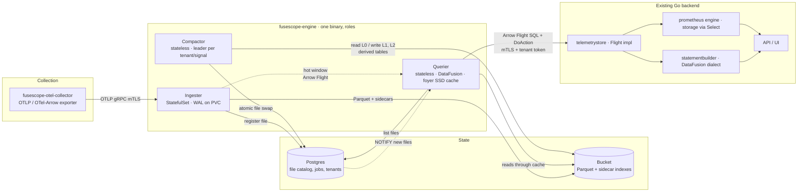

# FuseScope Engine · architecture design

> Status: proposal, 2026-10-24. Storage and query engine for OpenTelemetry
> telemetry (traces, logs, metrics) on object storage, candidate to replace
> ClickHouse in FuseScope.
> Engine license: Apache-2.0. Dependencies must be MIT, BSD, ISC or Apache-2.0.

## 1. Why an engine of our own

FuseScope inherited from SigNoz a Go backend coupled to ClickHouse at three
points: the `telemetrystore.TelemetryStore` interface returns a raw ClickHouse
connection, the `statementbuilder` packages emit ClickHouse-dialect SQL, and
dozens of materialized views in the collector schema do pre-aggregation.
ClickHouse delivers performance, but it costs expensive local disk, its own
replication, rebalancing on scale-out, and it ties the schema to an AGPL
repository.

The engine trades that for **stateless compute over a shared bucket**: Parquet
on S3, GCS, Azure Blob or MinIO, vectorized queries with Apache DataFusion, a
local SSD cache, and a small catalog in the Postgres we already run. Scaling is
adding queriers. Retention costs bucket prices.

This is not a ClickHouse reimplementation. It is an engine specialized in three
signals with known access patterns: filter by time and service, lookup by id,
aggregate by window, and text search over logs.

## 2. Architecture



In one sentence: collectors send OTLP to ingesters, which write a local WAL,
buffer in memory and flush Parquet plus indexes to the bucket, registering each
file in the catalog. Stateless queriers plan against the catalog, read the
bucket through an SSD cache, merge the hot window held by ingesters and answer
in Arrow Flight to the Go backend. A compactor keeps files large and sorted and
materializes the derived tables that replace the ClickHouse views.

### 2.1 Roles

| Role | State | Scaling | Responsibility |
|---|---|---|---|
| Ingester | WAL on local disk (PVC) | StatefulSet; tenant sharding by consistent hash in the collector or by a sticky load balancer | Receive OTLP/OTel-Arrow, validate, write WAL, buffer as Arrow, flush Parquet L0, serve the hot window |
| Querier | Cache only | Deployment, HPA on CPU and queue depth | Flight SQL and typed actions, catalog-driven planning, pruning, reads through foyer, fan-out to ingesters |
| Compactor | None | Deployment; one leader per (tenant, signal) via a Postgres lease | Merge L0 → L1 → L2, re-sort, rebuild indexes, derived tables, retention |
| Catalog | Postgres | Already in the stack | File list with summaries, compaction jobs, tenants, leases |

`--role all` runs the three roles in one process for development and small
installs, with MinIO or local disk as the bucket.

### 2.2 Write path

```
OTLP ──► authentication (mTLS or per-tenant bearer)
     ──► limits: message size, attributes per record, value size,
         new attribute keys per tenant per hour
     ──► normalization into the signal's Arrow schema (section 4)
     ──► WAL: append-only segment, record = len + crc32c + raw OTLP payload
         group commit: one writer thread drains the queue, appends the batch,
         fsyncs once and acknowledges every request in it; rotate every 64 MB
     ──► in-memory buffer: RecordBatches per (tenant, signal), sorted at flush
     ──► flush when: 128 MB, or 30 s; rows spanning hours are cut into
         one file per hour, so no L0 file holds two
         1. sort each batch by (service_name, timestamp, row), merge them
            into row groups of `row_group_rows`, encode each as it completes
         2. write Parquet L0 to the bucket under a temporary path
         3. write index sidecars (section 5)
         4. INSERT into the catalog with state "visible"
         5. retain the rows in memory, then confirm the registration: the
            compactor's delay counts from the confirmation
         6. checkpoint the WAL at the first still-buffered or unconfirmed
            record, after the flush and again once the confirmation lands
```

A file exists for the querier only after the catalog INSERT. Three things
make the flush idempotent under crashes at any step, with other requests
arriving meanwhile:

- The file id is derived from the WAL instance id (created with the WAL
  directory, so two ingesters or a recreated volume never collide), the tenant
  and the smallest WAL position in the buffer. Replay rebuilds the same
  minimum from the records, so the id survives a restart with no state beyond
  the log. The hot window takes its snapshot under the exclusive gate, with no
  request between its append and its push, so the id it announces for live
  rows is the id their file gets.
- Before uploading, the ingester appends a flush intent to the WAL naming the
  file id and the exact record range it covers. The range is exact because
  requests append to the WAL and to the buffer under a shared gate that the
  flush takes exclusively while it cuts the buffer, and its start is the
  smallest position in the buffer, not the position of the record that got
  there first. Replay groups records
  under their intents, so a retry produces the same object and the same
  catalog row even if later rows arrived during the original flush. A cut
  makes one file per calendar hour its rows fall in, at most
  `ingest.max_hours_per_cut` of them (8, never above 64), oldest first,
  each under the id derived from the range's first position and that hour
  and under an intent naming that hour: an intent claims the rows of its
  hour and no other, so rows left live, by the bound or by an intent that
  could not be logged, are cut later under their own hour over a range that
  may overlap, and a replay still gives every row to one file; a stop cuts
  until nothing is left live or a pass cuts nothing. The hours of a batch
  are taken once, when it is made, and kept with it: a cut and a hot scan
  read them, a batch of one hour moves whole, and only a batch spanning the
  hours cut and others is partitioned, in one pass. A request whose spans
  fall in more than `ingest.max_hours_per_batch` hours (48) is refused, and
  a tenant whose rows would fall in more than `ingest.max_live_hours`
  (64) is refused and marked due, so the next flusher pass cuts it
  whatever its rows, bytes and age and the request is admitted again once
  the files are registered. The count takes the live rows, the rows being
  flushed, whose intent may still be on its way to the log and whose rows
  come back if it fails, and the requests admitted but not yet pushed, so
  nothing slips in between a cut and its log, and the mark outlives a cut
  whose intent failed; no cut, scan or announcement grows past that. An
  intent naming an hour is written
  under WAL record version 2, so an ingester of the previous version fails
  on it instead of reading the intent as the whole range; the reader fails
  closed on a version and an hour that do not match. The hot window
  announces, for the live rows, the id of every hour they fall in, so a
  querier excludes the files whichever way the cut goes.
- Uploads never overwrite (conditional create), and registering an existing
  id verifies the immutable fields; a mismatch is an error, never a silent
  accept.
- Every writer records the sha256 of the object on its catalog row
  (`content_sha256`), the flush and the compactor alike, computed where the
  bytes are encoded. A retried flush that meets its object already in the
  bucket streams it back and compares the digest, not only the size: other
  bytes under a recorded layout mean a corrupt object or a broken encoder,
  so the rows take a fresh id as they do for a doomed path, the object is
  left to the orphan sweep and `fusescope_flush_replay_mismatch_total`
  counts it; an intent logged before layouts were recorded registers the
  object it finds, with its digest. Rows from before the column existed
  carry no digest and are accepted as they are.

The checkpoint is a durable marker next to the segments: replay after a
restart starts there, which is what prevents rows already in the bucket from
being flushed twice. Its cut is chosen under the same exclusive gate, so a
record accepted while the checkpoint is chosen is above the cut and replay
still finds it.

Memory the caps do not see is bounded separately: at most `max_conversions`
requests are converted to Arrow before admission at a time, and a merge
reserves its inputs inside `max_memory_bytes`, never on top of it, taking at
most `coalesce_bytes` of them and nothing when the headroom holds fewer than
two adjacent batches. Admission keeps room for three copies of every live
byte, for the merged rows, the sorted rows and the encoder of its flush, so
the rows that fill the cap can always be the rows that free it; when the
rows are cut that room becomes the attempt's lease, held whole until the
object is in the bucket and its bytes are dropped, then lowered to the rows
kept for the hot window. Rows whose attempt failed count toward the room
again until the retry takes them. A batch larger than `coalesce_bytes` is
merged with nothing: it is taken as a run of its own when the headroom
allows and gets its trace set like any chunk, and groups are chosen around
it. Every request batch carries the worst case of its trace set in its
bytes, one id per row, until the chunk with the real set replaces it, so
the caps cover the index before it exists. The
gate covers only the append and the push of a request, so a flush cut, a
checkpoint or a hot-window snapshot waits for the requests in that window,
not for the conversion queue; the hot-scan and checkpoint latencies are
exposed as histograms.

Buffers keep batches in WAL order, the order replay produces, so a file holds
the same rows in the same order whether it was built from live batches or
from replayed records, and a retry after a crash reproduces the object byte
for byte: every batch is sorted on its own with its row position as the last
key, and the k-way merge breaks ties by input order, so the batching of the
rows never shows in the file. The writer holds one row group of pages at a
time; its peak is measured per flush and published, which is what turns the
flush lease's three copies from an estimate into a checked bound. Request batches are small, a dozen spans, and a flush would
concatenate thousands of them, so a coalescer merges complete runs of them
into chunks in the background: a run is complete when every position in it
is below the smallest position still travelling from the log to a buffer,
which the WAL writer tracks. Chunks preserve the order, cost a few
milliseconds each outside every lock, and pack live rows into a fraction of
the memory of the batches they replace. Up to `max_coalesces` chunks are
built at a time, each over its own run, so one tenant's backlog is merged
on several cores. A flush is cut inline but encoded, uploaded and registered
on its own task, at most `max_flushes` at a time, so the flusher keeps
coalescing while a file is written; a chunk finished after its rows were
cut replaces them in the flushing rows. What the hot window keeps after
registration is the file's rows as written, one sorted batch, for
`persisted_retain`: the querier scans the hot window first and lists files
after, so the retention must cover its file cache TTL plus one hot scan, and
the server refuses a shorter value. A hot scan carries the trace and span
ids a query pins, so a lookup ships those rows and no others; every chunk
and every retained file batch carries the set of trace ids it holds, built
when the batch is made, so a lookup skips the batches that hold none of
them without reading a row.

### 2.3 Read path

```
Flight SQL / DoAction
  ──► authentication: backend mTLS + tenant JWT signed by the backend
  ──► read-only session: logical catalog holds only this tenant's tables
  ──► DataFusion planning
        prune 1: catalog      → files by time range and service set
        prune 2: indexes      → id bloom/xor, label postings, body ngrams
        prune 3: row groups   → min/max statistics from the Parquet footer
        prune 4: pages        → page index
  ──► budget: estimated bytes, files, memory; refuse before executing
  ──► vectorized execution, coalesced reads via object_store, foyer cache
  ──► union with the hot window: Flight fan-out to the tenant's ingesters
  ──► RecordBatch stream to the Go backend (zero-copy in arrow-go)
```

## 3. Bucket layout

```
s3://fusescope/
  t/{tenant_id}/
    traces/
      l0/dt=2026-10-24/hr=14/{ulid}.parquet
      l0/dt=2026-10-24/hr=14/{ulid}.idx          # sidecar: filters + summary
      l1/dt=2026-10-24/hr=14/{ulid}.parquet      # ~512 MB, closed hour
      l2/dt=2026-10-24/{ulid}.parquet            # ~1 GB, closed day
      derived/trace_summary/dt=.../hr=.../{ulid}.parquet
      derived/service_graph_1m/dt=.../hr=.../{ulid}.parquet
      derived/duration_sort/dt=.../{ulid}.parquet
      index/trace_id/dt=2026-10-24/hr=14/{ulid}.tix   # trace_id → files
    logs/
      l0/ l1/ l2/ derived/ index/ngram/...
    metrics/
      series/dt=.../{ulid}.parquet                # fingerprint, labels
      samples/l0/ l1/ l2/...                      # fingerprint, ts, value
      derived/rollup_5m/ derived/rollup_30m/
      index/postings/dt=.../hr=.../{ulid}.pst     # label=value → fingerprints
    tmp/{ulid}.parquet                            # write in progress
```

Rules:

- `tenant_id` is the first path component. It enables per-prefix IAM
  policies and tenant deletion by prefix.
- Day and hour partitions match time pruning and retention, which deletes
  whole prefixes.
- ULID names are sortable by creation time and collision-free across
  ingesters.
- Nothing is overwritten. Compaction writes new files and swaps the list in
  the catalog in one transaction. Old files are quarantined and deleted after
  the in-flight read TTL (default 1 h).

### 3.1 Parquet parameters

| Parameter | Value | Reason |
|---|---|---|
| Compression | zstd level 3 at L0, level 7 at L2 | L0 optimizes flush latency, L2 optimizes bucket cost |
| Row group | 1 M rows or 128 MB | Pruning granularity without a huge footer |
| Page index | on | Pruning inside a row group |
| Dictionary | on for low-cardinality strings | service_name, status, severity |
| Native bloom | spans: trace_id, span_id, service_name; logs: trace_id, service_name; metric_name; each sized to the row group at 1 % false positives, no other column | Row-group pruning on equality |
| Sort order | traces and logs: (service_name, timestamp); samples: (fingerprint, timestamp) | Locality for the dominant filters |
| Target size | L0 128 MB, L1 512 MB, L2 1 GB | Fewer footers to fetch, larger sequential reads |

### 3.2 Catalog in Postgres

```sql
create table engine_file (
  id             uuid primary key,
  tenant_id      uuid not null,
  signal         smallint not null,           -- 1 traces, 2 logs, 3 metric samples, 4 metric series, 10+ derived
  level          smallint not null,           -- 0, 1, 2
  path           text not null unique,
  size_bytes     bigint not null,
  row_count      bigint not null,
  ts_min         timestamptz not null,
  ts_max         timestamptz not null,
  services       text[] not null default '{}', -- coarse pruning summary
  summary        bytea,                        -- binary summary: small filters, min/max of promoted columns
  content_sha256 bytea,                        -- sha256 of the object as uploaded; null on rows from before it was recorded
  state          smallint not null,           -- 0 writing, 1 visible, 2 quarantined
  created_at     timestamptz not null default clock_timestamp(),
  confirmed_at   timestamptz,                 -- set by the writer once it retains the rows; null keeps the file out of compaction
  quarantined_at timestamptz
);
create index on engine_file (tenant_id, signal, ts_min, ts_max) where state = 1;

create table engine_compaction (
  id          uuid primary key,
  tenant_id   uuid not null,
  signal      smallint not null,
  inputs      uuid[] not null,
  outputs     uuid[],
  state       smallint not null,
  lease_owner text,
  lease_until timestamptz
);

create table engine_tenant (
  id              uuid primary key,
  retention_days  int not null default 15,
  max_keys_hour   int not null default 5000,  -- attribute key cardinality limit
  bytes_budget    bigint not null,             -- per-query scan budget
  qps_limit       int not null
);
```

The catalog is the single source of truth for which files exist. Each querier
keeps an in-memory copy per tenant, refreshed by `LISTEN` plus a safety poll
every 5 s. For interoperability with Trino, DuckDB and Spark the compactor
writes **Apache Iceberg** metadata for level L2 asynchronously. Iceberg is an
exported view, never the hot write path.

## 4. Arrow schemas

Schemas are versioned in `fs-schema`. Old and new files coexist because
DataFusion merges schemas and fills missing columns with null.

**Compatibility rule (ADR 0007).** Logical field names and semantics follow
the ones the Go backend already uses in `pkg/telemetryschema` and the
`statementbuilder` packages, so the DataFusion dialect is a syntax
translation, not a model translation. Physical encoding is chosen for Parquet
and diverges from ClickHouse where that pays off. CamelCase aliases
(`traceID`, `durationNano`, `serviceName`) and the v2 tables they served are
not carried over.

**Clean-room rule (ADR 0008).** The OTLP to schema mapping is specified from
the OpenTelemetry protocol and semantic conventions and from observed data,
never from the AGPL exporter code in the collector repository.

### Spans

| Column | Type | Note |
|---|---|---|
| ts_bucket_start | UInt64 | virtual partition column, seconds, 30 min buckets; the query builder already emits this predicate |
| timestamp | Timestamp(ns, UTC) | span start |
| trace_id | FixedSizeBinary(16) | binary, not hex; `hex()` UDF for the UI; literals converted by the dialect |
| span_id | FixedSizeBinary(8) | |
| parent_span_id | FixedSizeBinary(8) nullable | |
| trace_state | Utf8 | |
| flags | UInt32 | |
| name | Dictionary(Utf8) | |
| kind | Int8 | OTLP enum |
| kind_string | Dictionary(Utf8) | |
| duration_nano | UInt64 | |
| status_code | Int16 | OTLP enum |
| status_code_string | Dictionary(Utf8) | |
| status_message | Utf8 | |
| has_error | Boolean | status_code == ERROR |
| is_remote | Dictionary(Utf8) | |
| resource_fingerprint | UInt64 | xxh3 of the sorted resource attributes; internal, never compared across engines |
| resources_string | Map(Utf8, Utf8) | |
| attributes_string | Map(Utf8, Utf8) | |
| attributes_number | Map(Utf8, Float64) | |
| attributes_bool | Map(Utf8, Boolean) | |
| scope_name, scope_version | Utf8 | |
| scope_string | Map(Utf8, Utf8) | |
| events | List(Struct{timestamp, name, attributes}) | structured, no JSON strings; event attributes as a text map |
| links | List(Struct{trace_id, span_id, trace_state, attributes}) | |
| service_name, http_route, ... | Dictionary(Utf8), nullable | promoted columns with flat snake_case names, registry in `fs-schema` (`PROMOTED`); the Go storage layer maps logical attribute to physical column, as it does today for `attribute_string_http$$route` |

Promoted from day one because the Go backend and the UI depend on them:
`service.name` (resource), `http.route`, `http.request.method` and legacy
`http.method`, `http.response.status_code` and legacy `http.status_code`,
`db.system`, `db.name`, `db.operation`, `rpc.system`, `rpc.service`,
`rpc.method`, `messaging.system`, `messaging.operation`, `peer.service`,
`deployment.environment.name` and legacy `deployment.environment`. Each
column tries current and legacy semconv keys in order. The full rule set with
sources is `crates/fs-schema/MAPPING.md`.

### Logs

ts_bucket_start, timestamp, observed_timestamp, id (ULID, UInt128 as
FixedSizeBinary(16)), trace_id, span_id, trace_flags (UInt32),
severity_text (Dictionary), severity_number (UInt8), body (Utf8),
resource_fingerprint, resources_string, attributes_string, attributes_number,
attributes_bool, scope_name, scope_version, scope_string, promoted.*.

trace_id and span_id are nullable: a record outside a trace stores null. The
id is a ULID whose random part is a hash of the request's origin and the
record's position in it, so a WAL replay produces the same ids. The body is
text; structured bodies are stored as JSON. `service_name` and
`deployment_environment` are promoted as for spans. Files carry bloom filters
on `trace_id` and `service_name`. The rules are in `crates/fs-schema/MAPPING.md`.

### Metrics

`series`: fingerprint (UInt64), metric_name (Dictionary), temporality
(Dictionary), type (gauge, sum, histogram, exp_histogram, summary), unit,
description, is_monotonic, labels (Map(Utf8, Utf8), not a JSON string),
first_seen, last_seen.

`samples`: fingerprint, metric_name (Dictionary, kept for file pruning),
unix_milli (Int64), value (Float64). The `env` column of `samples_v4` is not
carried over; it is a label. Histograms are exploded into one series per
bucket at ingest, as Prometheus does. Exponential histograms keep a dedicated
Struct column.

## 5. Indexes

Indexes live in the bucket next to the data and are **rebuilt by the
compactor** at every level. They are never the source of truth.

| Index | Format | Serves | Reference |
|---|---|---|---|
| Native Parquet bloom | inside the file | equality on trace_id, span_id, service_name, metric_name | parquet-rs |
| `.idx` sidecar | xor filter per column + min/max of promoted columns | file pruning without opening the footer | Tempo |
| `index/trace_id/*.tix` | sorted table trace_id → file list, per hour | open two or three files for a trace instead of thousands | Tempo |
| `index/ngram/*.ngb` | ngram (n=3) and token bloom over body, per file | `LIKE`, `contains`, log text search | ClickHouse ngrambf_v1 |
| `index/postings/*.pst` | roaring bitmaps, label=value → fingerprints, per hour | PromQL matcher resolution | Prometheus TSDB |
| Tantivy (phase 2) | inverted index per file | full-text search with ranking and phrases | Quickwit |

Every sidecar carries a header with version, length and an xxh3 checksum. A
corrupt or missing sidecar degrades to a file scan, never to an error.

The `trace_id` sidecar (`fs-index::trace_index`, format version 1) is a
sorted table of `(trace_id, file)` pairs over a list of file paths. The flush
writes one per L0 file, derived from the trace sets of its row groups, after
the Parquet object and before the catalog row, under the create-once rule: a
sidecar already there must be byte for byte the one the rows produce, or the
file is not registered, since a valid sidecar listing other traces would hide
the file. The compactor will merge them into one per hour. The querier
derives the sidecar path from the file path, so the catalog does not list
sidecars. A lookup that pins trace ids fetches the sidecars of the files the
catalog keeps, in parallel, and opens only those listing one of the ids in
that file; a sidecar that does not cover the file is not trusted. Decoded
sidecars stay in memory up to `query.trace_index_cache_bytes`, a ceiling on
what the cache makes the process hold: decoded sidecars alive anywhere,
including ones evicted while a query still uses them, plus downloads in
flight. A download holds a lease, one per file at a time, that reserves the
announced object size before a byte is read and, measured from the frame
before a byte is decoded, the heap the index keeps plus the decoder's scratch,
evicting idle entries to make room; the decoder allocates exactly what was
measured;
dropping the lease on a timeout returns everything. One larger than the
budget is never read, and one that finds the budget busy is skipped for that
query. A file whose sidecar is missing, unreadable, too large or naming other
files is remembered as such and scanned. Fetches, misses and pruned files are
counted.

### 5.1 One compactor per deployment

The compactor takes the `compactor` lease in the catalog (`engine_lease`,
migrations 0004 and 0005) before it works: one statement takes or renews the
lease when it is free, expired or already this holder's, evaluated on the
database clock. The holder is the node id plus an id of the process
incarnation, so two processes configured alike are two holders. Every change
of hands bumps the lease generation; the holder quotes holder and generation
as a fence, and a swap checked against a stale fence changes nothing
(`swap_files_fenced`, `CatalogError::LeaseLost`); the check locks the lease
row until the swap commits, so a takeover waits behind it and a swap that
waited behind a takeover is refused. The lease is renewed every third of
`compactor.lease_ttl_secs` on its own loop, never behind the work: the work
runs on a task started when the lease is taken and aborted, and waited for,
when it is lost, so a slow pass neither lets the lease lapse nor outlives it.
A renewal is bounded by the renewal period, and a catalog failure or timeout
on renewal counts as losing the lease, so a partitioned or stuck instance
stops working before the TTL rather than racing the next holder. Release lets the
lease expire at once, keeping the generation. A purge deletes the catalog
rows of files quarantined for `compactor.quarantine_ttl_secs` on the database
clock, each in a transaction that holds the locks of its path and sidecar
and marks both for deletion, then each object and its `trace_id` sidecar
under the claim protocol of the orphan sweep (section 7.2), leaving
tombstones: from the row's commit on, a writer replaying the file, before
the delete or however long after it, is refused with `ObjectDoomed` and
gives its rows a fresh id, so no row ever points at an object the purge
deletes, and a replayed file beyond retention is expired again by the
next retention pass. An object the purge cannot delete keeps its mark and
is finished by the sweep. The server refuses a TTL shorter than the
querier's file cache TTL plus one query timeout, since a querier may still
read a quarantined file that long.

## 6. Hot window

Data from the last seconds up to the flush exists only in the ingester. The
querier needs it for "last 5 minutes" dashboards.

- Each ingester exposes Flight with `hot.scan(tenant, signal, range,
  projection, filter)` over its in-memory RecordBatches.
- The querier asks the catalog how far the bucket covers (`max(ts_max)` per
  tenant and signal) and sends ingesters only the range after that.
- The merge is a DataFusion `UnionExec` with deduplication on
  `(ingester_id, wal_offset)` for the case of a flush concurrent with the
  query.
- Ingesters are discovered through the catalog (heartbeat every 2 s in
  `engine_ingester`). An ingester silent for 10 s is skipped and the querier
  marks the result as partial in a Flight header.

## 7. Compaction and derived tables

```
L0  (128 MB, per flush)      ──► L1 (512 MB, closed hour, re-sorted)
L1  (24 files of one day)    ──► L2 (1 GB, closed day, zstd 7, promoted columns)
```

At every level the compactor:

1. Reads the inputs, re-sorts, writes outputs under `tmp/`, writes new
   sidecars.
2. In one transaction: marks inputs `quarantined`, inserts outputs as
   `visible`. Queriers holding an older copy keep reading the inputs until
   the quarantine TTL, with no error.
3. Updates derived tables incrementally from the inputs.
4. Decides promotions: an attribute filtered in more than N% of the last
   week's queries, using querier statistics, becomes a native column at L2.

### 7.1 L0 to L1

A pass takes the oldest cold hour, across tenants: one whose visible L0
files number at least two and all ended, and were confirmed, more than
`compactor.hour_close_delay_secs` ago, so the hot window has let go of them
and late data is no longer arriving. The ingester confirms a registration
in a second statement once the rows are retained in memory for it, so the
delay never counts from a row stamp taken before a commit that came later;
a file whose writer died before confirming keeps its hour open until the
replay confirms it. The confirmation runs off the flusher: a flush returns
once its rows are retained, and the confirmer attempts each confirmation
on one of `ingest.max_confirms` permits, within `ingest.confirm_timeout_secs`,
with the flush backoff after a failure, so a catalog that is down never
holds a flush or a stop; a finished attempt starts the next one due, so a
backlog drains at that many calls at a time. An attempt cancelled by the
stop gives its entry back, and the stop then confirms everything due,
refilling the permits, for the timeout at most.
The pending count is the `fusescope_flush_unconfirmed` gauge. A confirmation
changes nothing a querier reads, so the catalog does not announce it: the
change notification fires for the columns queriers read, and a column
added for them is added to the trigger. Hours are UTC bins of `ts_min`
whatever the session time zone, and hour and files are read in one
repeatable-read snapshot, so a file registered meanwhile is neither counted
nor taken. It merges the hour's oldest files up to
`compactor.max_inputs_per_pass` and `compactor.max_input_bytes`, a ceiling:
an hour whose two oldest files do not fit is passed over, reported once, and
the next cold hour is tried, so one oversized hour never blocks the queue;
the server refuses a cap under twice the ingest buffer so two L0 files
normally fit. A large hour closes over
several passes; an hour left with a single L0 file keeps it. A pass runs
only under the lease fence; without one it does nothing. Every input is already sorted by `(service_name, timestamp)`, so the
merge is a k-way heap over one row group per input, ties in registration
order, producing row groups of the ingester's size through the same writer
settings as the flush (`fs-schema::parquet`), a null service before every
name as the inputs sorted it; an L1 file closes once it reaches
`compactor.l1_target_bytes` and is uploaded, under the create-once rule,
before the next one starts, so memory holds one decoded row group per
input, the row group being gathered and the compressed bytes of the one
file being written. Outputs go to `traces/l1/dt=…/hr=…/{id}.parquet`, each
with its own `trace_id` sidecar; once all are in the bucket, one fenced
swap quarantines the inputs and publishes the outputs. A crash or failure
before the swap commits leaves the inputs visible and every object created
so far as an orphan for the orphan sweep, counted whatever the failure; a
swap refused for a conflict or a lost lease leaves them the same way; a
crash after the swap leaves the inputs quarantined for the purge. The
ingester cuts flushes at the hour, so an L0 file is within the hour of its
`ts_min`; a file of the previous version that crossed the boundary belongs
to that hour and the output carries the real range of its rows, so pruning
stays correct. The merged per-hour
`trace_id` index waits until an hour's file set is final.

Derived tables replacing the ClickHouse materialized views:

| Derived | Replaces | Key |
|---|---|---|
| trace_summary | signoz_traces.trace_summary | trace_id, start, end, num_spans, services, has_error |
| service_graph_1m | dependency_graph_minutes | (src, dst, dst_kind, minute): count, error_count, quantiles via t-digest |
| duration_sort | durationSort | top-k per service and operation, per hour |
| usage_1h | usage | bytes and rows per tenant, signal, service, hour |
| attribute_keys | tag_attributes, span_attributes_keys | key, type, count, first and last seen |
| rollup_5m, rollup_30m | samples_v4_agg_5m, samples_v4_agg_30m | fingerprint, window: min, max, sum, count, last |

`trace_summary` and `service_graph_1m` are immutable contributions of one
L0-to-L1 pass, not global tables. The pass builds them while it streams the
same rows into L1, uploads at most one file of each, and publishes them in
the same fenced catalog swap as the L1 outputs and `attribute_keys`. A crash
or refused swap therefore publishes none of them and leaves every created
object to the orphan collector. If an hour needs several passes, it has
several partial files and the query combines them: trace summaries use
`min(start)`, `max(end)`, `sum(num_spans)`, unioned services and
`bool_or(has_error)`; graph rows use `sum(count)`, `sum(error_count)` and
`quantile_tdigest(digest, q)`. The quantile is normally a `Float64` in
`[0, 1]`; an integer literal is accepted only for the exact endpoints `0`
and `1`, so percentiles such as p99 are written as `0.99`, not `99`.

The summary file's catalog range is the minimum and maximum **span start**
in the pass, which is already confined to one hour. `end` stays in the rows
for trace-overlap filtering, but never extends retention because a bad end or
a legitimately long span can be arbitrarily distant. Consequently catalog
pruning of this table uses `start` only; predicates on `end` are applied after
the file is opened. The range therefore expires with the L1 trace files made
from the same pass.

The summary has one row per trace in the pass. The service graph resolves a
direct CLIENT-to-SERVER or PRODUCER-to-CONSUMER edge by
`(trace_id, parent_span_id)` after all rows of the pass arrived. An unmatched
CLIENT or PRODUCER may instead name a database, queue, service or external
endpoint from `db.system`, `messaging.system`, `peer.service`,
`server.address` or `net.peer.name`, in that order. `dst_kind` records which.
The child, or the unmatched outbound span, supplies the minute, error and
latency. Parent-child pairs split across an hour or pass are deliberately
absent; hot data is likewise absent until its closed hour compacts, and the
Go layer reads `spans` for that recent interval.

Both formats carry signal and version metadata and have an exact, non-null
physical layout. The graph digest has its own versioned binary envelope over
DataFusion's t-digest centroids, count, min, max and sum. A pass whose trace
map crosses `compactor.trace_summary_max_traces` or
`compactor.trace_summary_max_bytes`, or whose span map crosses
`compactor.service_graph_max_spans` or `compactor.service_graph_max_bytes`,
skips that whole contribution and increments the corresponding
`_skipped_total`; it never publishes a partial derived file. The first skip
for a tenant, hour and derived signal is also warned with the limit, cap,
observed value and estimated bytes. Service and destination names are interned
once per builder.

The charged footprint is derived from the retained Rust layouts instead of a
fixed per-row guess. A trace pays its key, `TraceSummary`, four machine words
of B-tree slack and the fixed Arrow output columns; each trace/service link
pays vector slack, offsets and one output copy of the UTF-8 bytes, while an
interned name is charged once. A graph span pays `SpanKey`, `SpanMeta`, four
machine words of B-tree slack, its finish-time resolution reference and one
`f64` latency. On a 64-bit build that is 168 bytes per span, so the default
256 MiB covers about 1.5 million spans before the comparatively small shared
name and distinct-edge charges. Names pay hash-table/allocation slack plus
their UTF-8 bytes only when first interned. Each distinct edge, rather than
each span observation, additionally reserves both aggregation maps, a maximum
size digest and its encoded copy, and the two output copies of its names;
every latency observation was already reserved by its span. All charges are
taken before the allocation they protect, including finalization. The two
byte caps together may not exceed 1 GiB; their defaults are 256 MiB each.
Graph resolution and all derived Parquet encoding run on the blocking pool,
not on an async executor thread.

The format fixtures under `crates/fs-schema/tests/fixtures` are bytes emitted
by the first v1 writer and are decoded by every current test run. They pin
reader compatibility without pinning incidental Parquet writer metadata.

`attribute_keys` is the first of them: one Parquet file per tenant under
`t/{tenant}/derived/attribute_keys/dt=…/hr=…/{id}.parquet`, partitioned by
the hour of the pass that rebuilt it, with `key`, `source` (`resource`,
`span`, `scope`), `type` (`string`, `number`, `bool`), `count` of spans
carrying the key, counted once per span however often a span repeats a
key, `first_seen` and `last_seen`. Every L0 to L1 pass reads the tenant's
table before, counts the keys of the rows it merges into it, uploads the
new table under the create-once rule and swaps it in with the L1 outputs,
quarantining the table before, so a crash before the swap leaves the new
table an orphan and the table before in place. Any failure to read the
table before, transient or not, ends the pass before anything is created
(`fusescope_compaction_derived_unreadable_total`): the history is never
replaced by one pass's view, and a table damaged for good is repaired by an
operator, by rebuilding it from the L1 files, which is not automated: the
rebuild retention runs takes its admissions from the table before, so it
needs one it can read.
Every key records the hour whose budget admitted it (`admitted_hour`),
fixed once admitted, so late data of an earlier hour widens a known
key's count and sightings and never moves its charge, and an hour admits
at most the tenant's `max_keys_hour` keys new to the table over all its
passes, across restarts and whatever the pass size: each pass gets what
the table says is left for its hour. Within a pass
keys are admitted in merge order and never allocated for beyond the
budget (`fusescope_compaction_derived_keys_dropped_total`); which keys an
hour admits depends on how its files were split into passes, the total
does not. Keys of rows not yet compacted are not listed: the table lags
ingestion by the hour close delay. The format carries its signal and
version in the schema metadata and each version has one exact physical
layout, every column required (v2 the seven columns, `admitted_hour`
always the start of an hour; v1 the six, read with the hour of
`first_seen` in its place); the compactor and the querier both check
signal, version and layout before reading a file, the querier
from the footer alone, fetched by ranges once per path and shared by the
queries that meet a new path at the same time, since an object is never
rewritten, and refuse anything else, so an older engine never rewrites a
newer table and a file is never read as a version it is not.

Retention: every `compactor.retention_interval_secs` the leader quarantines
the files beyond their tenant's `retention_days`, first in the catalog,
then in the bucket. The cut is a UTC day boundary on the catalog's clock,
the start of the current day minus `retention_days`, and a file is beyond
it when every row of it ended before, so whole hour partitions of whole
days go and a file at the boundary stays. A pass takes the tenant whose
expired file is the oldest and quarantines up to
`compactor.retention_files_per_pass` of its files, oldest first, under the
fence (`expire_files_fenced`); the objects follow at the purge after
`compactor.quarantine_ttl_secs`, with their sidecars, as after a swap, so
a reader that opened one finishes. A crash anywhere leaves the catalog
ahead of the bucket, never behind it, queries right, and the next pass
continues with what is left; the orphan sweep removes whatever a day
prefix keeps beyond that. Bucket lifecycle rules are the safety net, never
the primary mechanism, because the catalog must never point at files that
do not exist. The immutable `trace_summary` and `service_graph_1m`
contributions expire by the same rule as their trace files and need no
rebuild. The `attribute_keys` table is a count over every row ever
compacted, with no per-day contribution to subtract, so once a tenant has
no expired file left and its table still lists a sighting before the cut
(`stale_derived_table`), the table is rebuilt from the L1 files that remain
at or after the cut, reading the timestamp and attribute columns only, one
batch at a time: a key is listed with the hour that admitted it in the
table before, a key the table before does not list stays out, as it was
when its files were compacted, and the budgets of the hours gone are not
re-spent. The new table is uploaded under the create-once rule and swapped
in under the fence, the table before quarantined with it, or the table
before is swapped out alone, without being read, when nothing remains. A
rebuild that does not commit, for a lost lease, a conflict, an unreadable
table before or L1 file, or a crash, leaves the table before in place and
the new table an orphan (`fusescope_retention_rebuild_*`). A tick
examines at most `compactor.rebuilds_per_tick` stale tables, 256 at most
and clamped there by the compactor itself, a table passed over counting
like one rebuilt, so the leader's purge, compaction and sweep are never
long behind the rebuilds whatever is held back or over a cap.
The stale tables are walked by earliest sighting with a keyset cursor
that outlives calls and ticks and wraps around at the end
(`stale_derived_table`), each table once a round whether its rebuild
went or not, so a round costs one query per table and however many
damaged tenants sort ahead of a healthy one, the tick's rebuilds reach
it in turn; a lost lease or a catalog failure, not the tenant's, leaves
the walk where it was. A failure on the tenant's own files, the table before or an
L1 unreadable, also holds the tenant back for
`compactor.rebuild_backoff_secs` times its failures so far, up to six
times, so a broken tenant is not read again every round while few tables
are stale; a success clears the count. A lost lease ends
the tick's work and a catalog failure ends the rebuilds for the tick. A
rebuild is admitted by what it reads and by what it holds: a tenant
whose remaining L1 files exceed `compactor.rebuild_max_input_bytes`, or
whose rebuild would hold more than `compactor.rebuild_max_bytes` at its
peak, keeps its table and is reported once, and the operator raises the
cap or waits for retention to shrink the set; a tenant with no L1 file
left is under no cap, since its table goes unread and nothing is
written. The peak is counted by the worst case the ingest
limits allow (`rebuild_footprint`): the list of inputs, the table before
as fetched and as decoded, by its row count, the rebuilt table, its
arrays and its Parquet bytes, the column chunks of the largest L1 file,
read one file and one row group at a time, and one decoded batch of
`REBUILD_BATCH_ROWS` spans with every attribute map full, the only part of
the peak the row count of the table does not bound; the server refuses a
budget below one L1 file of `l1_target_bytes` plus that batch. The inputs
are listed as path and size only, a page at a time in one repeatable-read
snapshot (`rebuild_inputs`), and the budget sees each page as it arrives
and ends the read on the first one that does not fit, so a list beyond
the budget is never held whole and what was admitted is what was read.

### 7.2 Orphan sweep

A crash between an upload and its registration, a compaction that did not
publish, or a cancelled pass leaves objects no row points at. The leader
sweeps the engine's prefix every `compactor.orphan_interval_secs`. Because
the sweep deletes whatever its catalog does not know, a prefix belongs to
exactly one catalog, durably: the catalog carries an identity given once
(`engine_catalog`), the first writer marks the prefix with it in
`{prefix}/_catalog`, created once and never rewritten, and every start
reads the marker and refuses a prefix marked for another catalog. A
prefix that holds objects and no marker is refused too, unless the
operator sets `bucket.adopt_prefix = true` for one start, which marks it;
a reader role meeting an empty, unmarked prefix proceeds and leaves the
marking to the writer. Nothing is written under a prefix before the claim
holds, the write probe included. The
bucket is walked by partitions, one tenant, level and day each, found with
delimiter listings as the walk reaches them, so no listing order is assumed
and nothing is enumerated ahead but the list of tenants; a pass walks whole
partitions until it has listed `compactor.sweep_objects_per_pass` objects,
then stops and the next pass continues from the next partition. That cap is
a goal, overshot by at most one partition, not a ceiling: a partition is
always walked whole, since the local store lists in no order a cursor could
resume from, and a partition is one tenant, level and day, so its size is
bounded by the ingest rate. A pass deletes at most
`compactor.sweep_deletes_per_pass`. Memory holds one chunk of paths, one
partition list and the tenant list at a time. Only paths the engine lays out count, parsed
strictly (tenant id, signal, level, a calendar date and hour, file id,
extension) when walked and again just before an object is marked; anything
else under the prefix, or remembered by an older version, is left alone or
forgotten, never deleted.

Deletion is a protocol with registration, through one row per path in
`engine_orphan` and a transaction advisory lock per path. The sweep records
an object's first sighting without a row (a sidecar has a row when the span
file of any level it could belong to has one). Once the sighting is older
than `compactor.orphan_ttl_secs` the sweep marks the row `deleting` in a
transaction that takes the path's lock first and reads the file rows by a
statement of its own after, so a registration that held the lock has
committed and its row is seen. Every registration, a flush's or a
compaction's, takes the locks of its path and sidecar in its own
transaction and is refused with `ObjectDoomed` when either row is marked.
The lock is not the row's, so the two serialise even before any orphan row
exists, and the one that commits first decides: a registration that wins
keeps its object; a mark that wins means the writer gives the same rows a
fresh id, logged as a second intent for the same records so a restart
retries under it too, and writes the same bytes under the new path. A path
once marked is never written again, since a delete still in flight when a
sweeper lost its lease could remove an object re-uploaded under it: a
deleted path stays in the catalog as a tombstone, refused to registration
for good, so a writer that was down while its object was deleted is refused
on its first retry, however late, and takes a fresh id too; a writer also
asks before uploading, so a refused path is not written again even as an
orphan, the registration's own check being the one that decides, and an
object that slips in between the two is seen by the sweep, which turns its
tombstone back into a mark and deletes it again. The id changes while the
failed attempt still holds the flush, so no concurrent retry takes the old
id meanwhile. The file keeps the id its rows were first assigned as its
`origin`, which the hot window announces: a querier excludes a file by its
id or its origin, so a flush that changed id between the hot scan and the
catalog read is still left out and its rows are never read twice. On
replay the origin is the id of the first intent logged for the records,
taken from the log rather than derived again, and the catalog refuses to
register an id again with another origin. Compaction publishes L1 files
under their own ids, so an hour closes only after the hot window could
have let go of every L0 in it: the server refuses an hour close delay under
the persisted retention plus a query timeout plus the file cache TTL. When
rolling the engine out, queriers go first, so every planner excludes by
origin before any ingester announces one, then compactors, so no leader of
the previous version, which closes an hour by the registration stamp
alone, meets an unconfirmed file of a new ingester, and ingesters last; a
server of the previous version registering files meanwhile gets the id as
origin and the registration stamp as confirmation from the catalog.
A mark is never undone: a sweeper that finds a row already marked, by an
earlier pass or by another instance during a handover, deletes the object
itself; only a path a file row owns, or one that is not the engine's, is
forgotten. A deleted path stays as a tombstone for good, one row per
deleted orphan, the record that the path is spent; there is no bound on how
long a cancelled delete request may take to land, so none on the tombstone. The delete and the forgetting run under a claim that holds the
path's lock in an open transaction, so two sweepers never delete the same
path, a registration re-uploading it waits for the claim to end, and a
sweeper whose claim finds the mark gone does nothing. A pass that stops
between marking and deleting is finished by the next. A delete that fails
keeps its mark and waits `compactor.sweep_delete_backoff_secs`, times the
failures so far, before its next try, behind the others, so the ones that
always fail do not take every pass's budget. Objects deleted by a
cancelled request to the bucket are the one case the sweep cannot see, and
the TTL covers it.

## 8. Contract with the Go backend

### 8.1 Transport

Arrow Flight over gRPC with mTLS between backend and queriers. Two kinds of
operation:

**Flight SQL** for everything that is generated SQL in the `statementbuilder`
packages today. Under `auth.mode = "token"` the ticket is the tenant id
followed by the SQL, as it has been since the first version, so a ticket
issued by any engine version executes on any other in that mode. Under
`auth.mode = "jwt"` it is `FST2`, the tenant id, the JWT subject's length
in two big-endian bytes, the subject and the SQL, and `DoGet` executes it
only for a token of the same tenant and subject; it needs no MAC, since a
caller writing its own ticket can only name itself. A `jwt` querier
refuses the old ticket, so queriers turn `jwt` on before the backend sends
JWTs, and every querier behind one endpoint is in the same mode. A
statement is planned once: `GetFlightInfo` plans
it, returns its schema and keeps the plan, keyed by tenant and SQL, oldest
first; `DoGet` re-authenticates, refuses a ticket of another tenant,
executes the oldest kept plan for its tenant and SQL and drops it, and only
plans the SQL again when no plan waits: after `query.prepared_ttl_secs`
(60, at most one day; a reaper drops expired plans as they come due,
whether or not anything else happens), beyond `query.prepared_plans` kept at once (1024) or
`query.prepared_bytes` retained together (64 MiB, estimated as SQL plus
displayed plan plus a 64 KiB allowance per session state; a plan over the
budget on its own is not kept), oldest dropped first, on a second `DoGet`
of the same ticket, or on another querier than the one that prepared it.
`fusescope_query_prepared_plans` and `fusescope_query_prepared_bytes` show
what waits. Dialect: DataFusion, close to PostgreSQL. Functions registered
by the engine: `attr_string(attributes, 'http.method')`, `attr_number(...)`,
`attr_bool(...)`, `has_attr(...)`, `body_contains(body, 'text')`,
`time_bucket(interval, ts)`, `quantile_tdigest(col, 0.99)`.

**Typed DoAction** for hot paths where SQL only gets in the way:

| Action | Input | Output | Used by |
|---|---|---|---|
| `trace.lookup` | tenant, trace_id, optional range | spans of the trace | trace detail view |
| `metrics.select` | tenant, label matchers, range, optional step | series with samples | Prometheus `storage.Queryable` in Go |
| `metrics.label_values` | tenant, label, matchers | values | autocomplete |
| `metadata.keys` | tenant, signal, prefix | attribute keys with type | query builder |
| `catalog.estimate` | tenant, SQL | bytes, files, row groups after pruning | `TelemetryStore.Estimate` |
| `catalog.explain` | tenant, SQL | logical and physical plan | `TelemetryStore.Plan` and `Indexes` |

An action is authenticated like a statement; the tenant is the token's.
Its body is JSON and its results are one Arrow IPC stream split in order
across the `Result` bodies: concatenated, they are the stream, the schema
in the first body, the end-of-stream marker in the last, which is how the
Go `Do` hands back an `arrow.RecordReader`. The row cap, the timeout and
the `x-fusescope-partial` header apply as for `DoGet`; `ListActions` names
the actions served. The timeout runs from the request's arrival, over
authentication, planning and every wait for a batch, so a stalled catalog,
a stalled store or a slow plan ends in `DEADLINE_EXCEEDED` too, and a
limit met while the stream is already flowing reaches the client with its
own code. `trace.lookup` takes
`{"trace_id": "<32 hex digits>", "start_unix_nano": n, "end_unix_nano": n}`,
the bounds optional and inclusive, any other field refused, and answers
every column of the spans table for that trace in
`timestamp` order; it goes through the spans table like SQL would, so the
`trace_id` sidecars, the hot window and the byte budget apply, without
parsing or planning SQL (`fusescope_query_trace_lookups_total`).
`metadata.services` takes `{"start_unix_nano": n, "end_unix_nano": n,
"limit": n}` and answers the distinct `service_name` of the tenant, sorted,
from the catalog alone: the services of every file overlapping the range,
so a range answers at file granularity, plus what the ingesters still hold
when the range touches the recent window, asked for the distinct names
only and for one more than the limit at most, so an ingester keeps and
sends each name once and never more than that; no file is read, and
more services than the limit is `RESOURCE_EXHAUSTED` as soon as it is
known, so the answer never holds more than that.
`metadata.operations` takes `{"service_name": s, "start_unix_nano": n,
"end_unix_nano": n, "limit": n}` and answers the span `name`s of that
service with their span counts, most frequent first, through the spans
table like SQL would. `metadata.keys` takes `{"signal": "traces",
"prefix": p, "limit": n}` and answers the rows of the `attribute_keys`
table (section 7) whose key starts with the prefix, most frequent first;
the table is also `attribute_keys` in SQL. A listing answers at most
`limit` rows, 1000 when absent, never more than `query.max_rows`
(`fusescope_query_metadata_lookups_total`). An unknown action is
`UNIMPLEMENTED`, a malformed body or a field the action does not know
`INVALID_ARGUMENT`.

### 8.2 Changes in Go

| Where | Change |
|---|---|
| `pkg/telemetrystore` | The interface stops exposing `ClickhouseDB() clickhouse.Conn`. It exposes `Query(ctx, stmt, args) (arrow.RecordReader, error)` and `Do(ctx, action, payload) (arrow.RecordReader, error)`. `flighttelemetrystore` is born next to `clickhousetelemetrystore`. |
| `pkg/statementbuilder/*` | Gain a dialect. ClickHouse SQL generation is already encapsulated here; the DataFusion version is a second backend of the same builders, tested against the same cases. |
| `pkg/prometheus/clickhouseprometheusv2` | Gains a sibling `flightprometheus` implementing `storage.Queryable` on top of `metrics.select`. The Prometheus PromQL engine stays in Go. |
| `pkg/telemetrymetadata` | Reads the `attribute_keys` derived table through `metadata.keys`. |
| `pkg/query-service/app/{logs,traces,metrics}/{v3,v4}` | Not ported. Legacy code that SigNoz itself is retiring in favor of querier v5. |
| `fusescope-otel-collector` | Swaps the ClickHouse exporter for the standard OTLP exporter pointing at the ingesters. The schema stops living in the AGPL repository. |

A `telemetrystore.provider: clickhouse | flight` flag selects the
implementation at runtime, allowing dual-write from the collector and result
comparison during migration.

## 9. Performance

### 9.1 Principles

1. **Never read what the query does not need.** Four pruning levels before a
   single data byte is read (section 2.3). The in-memory catalog answers
   level 1 with no I/O.
2. **Large, coalesced I/O.** `object_store` merges nearby byte ranges into
   one request. 128 MB row groups make sequential reads worthwhile.
3. **Layered cache.** foyer with memory and SSD: footers and page indexes of
   all visible files are pre-warmed when they enter the catalog; filters and
   postings are cached on first read; data pages use LRU with frequency-based
   admission so one-off scans do not evict the hot set.
4. **Hot window in memory.** The last seconds never touch the bucket.
5. **Pre-aggregate where the query is predictable.** Rollups, service graph,
   trace summary and duration sort are computed once by the compactor, not
   on every dashboard load.
6. **Zero-copy to Go.** Flight delivers Arrow IPC; `arrow-go` reads it
   without deserializing into structs.
7. **Budget before executing.** The planner estimates bytes and files after
   pruning. Above the tenant budget the query is refused with an error that
   says what to do, like the `Estimate` the backend already uses today.

### 9.2 Initial targets

Measured with a warm cache, 1 TB per tenant, 15-day retention, S3 bucket in
the same region. Phase 1 uses them to accept or reject the engine.

| Query | Target p95 |
|---|---|
| trace by id | 300 ms |
| span list, 1 service, 15 min, filter on a promoted attribute | 500 ms |
| p99 latency per service, 24 h | 2 s |
| logs, 1 service, 1 h, attribute filter plus `contains` on body | 1 s |
| PromQL rate over 200 series, 6 h, step 30 s | 800 ms |
| "last 5 min" dashboard, 8 panels | 1 s total |
| ingest per ingester (4 vCPU) | 150 MB/s of uncompressed OTLP |

### 9.3 Where ClickHouse still wins, and the answer

| Scenario | Why ClickHouse wins | Answer |
|---|---|---|
| High-cardinality GROUP BY over billions of rows, cold cache | local NVMe | foyer SSD cache pre-warmed from the catalog; sorted L2 reduces rows touched; budget refuses scans that do not fit |
| Data from right now | synchronous insert into the table | Hot window via ingesters |
| Materialized views | native | Compactor derived tables |
| Metrics with millions of active series | primary indexes in memory | Roaring postings per hour, cached; rollups; per-tenant cardinality limit |

## 10. Security

### 10.1 Tenant isolation

- `tenant_id` comes from the JWT signed by the Go backend, never from the SQL
  text. The engine builds one DataFusion logical catalog per session holding
  only that tenant's tables. There is no "global" table.
- Under `auth.mode = "jwt"` Flight SQL takes only the backend's tokens and
  refuses the catalog's static ones; `token`, the default, keeps them for
  development and `admin query`. `jwt` requires `[tls]` on, refused at
  start otherwise, since a bearer JWT is reusable by whoever reads it. A token is a compact JWS with `alg`
  `EdDSA` over Ed25519 and nothing else, verified through the crypto
  provider rustls already carries, with the `kid` of a key in the JWK set
  at `auth.jwt_keys`, an OKP Ed25519 set of public keys only (no `d`; any
  `use` is `sig`, any `key_ops` only `verify`) read again every
  `auth.jwt_reload_interval_secs` (60) and kept as last loaded when a read
  fails, so keys rotate by overlap. The claims are `iss` as
  `auth.jwt_issuer`, `aud` holding `auth.jwt_audience`
  (`fusescope-engine`), `sub`, the backend user or service acting, at most
  256 bytes, `fusescope_tenant`, the tenant's UUID, and integer `iat` and
  `exp` at most `auth.jwt_max_ttl_secs` (300) apart, with
  `auth.jwt_leeway_secs` (30) of clock tolerance and `nbf` honoured when
  present. The signature is checked before any claim is read, a token over
  8 KiB is not read at all, and the tenant must exist undeleted in the
  catalog, a live answer trusted for `auth.tenant_cache_secs` (10).
  Refusals count `fusescope_query_auth_refused_total`; the key set shows as
  `jwt_keys=` on `/readyz` and in `fusescope_jwt_*`.
- Per-prefix IAM policies on `t/{tenant_id}/` when a large customer gets its
  own bucket. For multi-tenant in one bucket, isolation is the engine's job,
  and the backend is the only network client of the engine.
- Deleting a tenant is: mark in the catalog, stop accepting ingest, delete
  the prefix, remove from the catalog. Audited.

### 10.2 SQL surface

Flight SQL exposes a general-purpose SQL engine. That is the largest attack
surface and is handled as follows:

- Sessions are always read-only. DDL, DML, `COPY`, `CREATE EXTERNAL TABLE`,
  `INSERT` and table functions that take a path (`read_parquet`, `read_csv`
  and the like) are removed from the function registry and rejected by the
  analyzer. A query that mentions them fails at parse time, also when
  wrapped in `EXPLAIN` or `EXPLAIN ANALYZE`, which would describe or run
  it; the planned tree is walked whole afterwards as a second gate that
  names every plan node and allows only the reading ones, so a node a
  DataFusion upgrade adds fails to compile until reviewed, and
  `Extension` is refused outright. One request is one statement. The
  query tests refuse each construct one by one (`sandbox` in
  `crates/fs-query/tests/query.rs`), the path-taking functions at planning
  alone, and `SELECT INTO`, a query by statement that plans to DDL, keeps
  the second gate exercised; CI proves the list.
- `information_schema` shows only the session tenant's tables.
- Per-query limits: memory through the DataFusion `MemoryPool` with spill to
  SSD, timeout, maximum files, maximum output rows, and the tenant byte
  budget.
- Per-tenant limits: QPS and concurrent queries, with fair queuing between
  tenants so a noisy tenant does not affect the others.
- Identifiers and literals keep going through `pkg/clickhousesql` in Go,
  renamed to a dialect-neutral package, because injection is prevented at the
  source.

### 10.3 Ingest

- mTLS between collector and ingester, or a per-tenant bearer token where the
  collector runs on the customer side.
- Tokens, ingest or query, are random `fst_` secrets stored as their sha256
  and shown once. An operator names one by its id, the first 8 bytes of
  that hash in hex, never by the secret: `admin token list` shows ids,
  names, scopes and state, `admin token revoke <id>` stops a token at once,
  and `admin token rotate <id> [overlap]` issues a successor with the same
  tenant, name and scope while the old one keeps working for the overlap
  (3600 s by default, at most seven days, never later than it was already
  due). `revoked_at` in the future is that scheduled end; an engine older
  than this reads it as revoked already, failing closed. A querier in
  `token` mode looks a token up on every request, so a change reaches it at
  once. An ingester caches a live answer for `ingest.token_cache_secs` (60,
  1 to 3600): an answer cached after a rotation never outlives the old
  token's scheduled end, the time left measured on the catalog's clock
  and counted from a monotonic instant taken before the lookup, so no wait
  before the answer is stored extends it, and an answer whose end came
  meanwhile is not stored; nothing tells an ingester of a change, so an
  answer cached before a revocation or a rotation lives out its TTL. A
  revocation or rotation therefore reaches every ingester within
  `ingest.token_cache_secs`, and a scheduled end may be passed by up to
  that TTL; an operator who needs faster lowers it. Invalidating the
  caches on the change would need the catalog to notify token changes, a
  migration left for later. Every issue,
  rotation and revocation logs a `fusescope::audit` event with the
  tenant, the token's id, name and scope.
- Limits: gRPC message size (default 16 MB), attributes per record, key and
  value size, nesting depth, and new attribute keys per tenant per hour.
  Above those, the record is accepted with the excess attributes dropped and
  a per-tenant drop counter, so a cardinality attack does not take down the
  pipeline of the tenant under attack.
- Per-tenant rate limit in bytes per second.
- WAL with crc32c per record, fsync per batch and a commit marker after each synced batch, so recovery cuts only what was never acknowledged and refuses to open on damage before it. PVC volume encrypted by the
  provider.

### 10.4 Data at rest and in transit

- Bucket with server-side encryption (SSE-KMS or equivalent), TLS required,
  public access blocked, optional versioning for tenants with immutability
  requirements.
- Three IAM identities: the ingester writes to `tmp/` and `l0/` and reads
  nothing; the querier only reads; the compactor reads, writes and deletes.
  Credentials via Kubernetes workload identity, never in configuration files.
- Phase 2: Parquet modular encryption per column for fields marked sensitive
  (log body, tenant-listed attributes), with a key per tenant. parquet-rs
  supports it.
- Catalog Postgres with TLS and one user per role, minimal `GRANT`s.
- mTLS on the Flight SQL listener and the internal hot-window Flight, under
  `[tls]`. A process has one identity, `tls.cert` and `tls.key`, that it
  serves with and presents as a client, so its certificate carries both the
  `serverAuth` and the `clientAuth` extended key usages. Each listener has
  its own bundle of client CAs: Flight SQL admits clients of
  `tls.public_client_ca`, the backend's, and the hot window clients of
  `tls.hot_client_ca`, the queriers'. The two are separate trust domains,
  because the hot window trusts the tenant in its ticket: a backend
  certificate that opened it would read any tenant without a bearer token
  or a JWT. A certificate verifies under whatever CA holds the key that
  signed it, whatever that CA's serial, validity or name, so every client
  CA must be a self-signed root, never an intermediate or a
  cross-certificate that could descend from a root of the other bundle,
  and no public key may appear in both bundles; both are refused at start
  and at reload. A listener refuses a client without a
  certificate from its bundle before any request is read. Clients verify
  the server against the operating system's trust store only, so a private
  CA is installed in the image's store, and against the host they dial, so
  an ingester advertises the name its certificate carries. The files are
  read again every `tls.reload_interval_secs` (60): contents that load go
  to new connections while open ones keep the config they began with, on
  the same listener; contents that do not load keep the last good config,
  count `fusescope_tls_reload_failures_total`, set `fusescope_tls_stale`
  and show `tls=stale` on `/readyz` without failing it, since every
  replica would read the same broken secret and the old config still
  serves. Replicas reload at different moments, so a CA rotation goes
  through a bundle holding both the old and the new CA until every client
  certificate is reissued, never a direct switch. Files that do not load at
  start stop the start. Handshakes run off the accept loop, each within
  `tls.handshake_timeout_secs` (10) and at most `tls.max_handshakes` (1024,
  never above 65536, clamped inside `fs-auth` as well) at a time per
  listener. `[tls]` is off by default for development, where the start
  warns, and half a section, on without its four files or off with files
  named, is refused; staging and production turn it on. Required before
  staging: refusing at start, and reporting, a certificate already expired
  or not yet valid, which today loads and fails every handshake. The OTLP
  listener of section 10.3 is not covered yet.

### 10.5 Supply chain and code

- `cargo-deny` in CI: allowed licenses are only Apache-2.0, MIT, BSD, ISC,
  Unicode and Zlib; RustSec advisories block the merge; crates.io is the only
  source.
- `#![forbid(unsafe_code)]` in every crate except `fs-cache` and `fs-index`,
  which may need audited `unsafe` for mmap, each block justified in a
  comment.
- Distroless image (`gcr.io/distroless/cc-debian12:nonroot`, uid 65532),
  non-root process, read-only filesystem except the WAL and spill volumes,
  the Debian CA bundle as the only trust store (`docs/ops/image.md`). The
  binary's crates as a CycloneDX 1.5 SBOM, generated at build by
  `cargo-cyclonedx` and shipped in the image and as a CI artifact.
- Engine logs never contain telemetry payloads, tokens or keys. `debug` logs
  ids and sizes, not bodies.
- Every query produces an audit event with tenant, JWT subject, query hash,
  bytes read, duration and outcome, delivered to the backend through the
  hooks `telemetrystore` already has. The engine side logs one event per
  `DoGet` and `DoAction`, refused ones included, under the
  `fusescope::audit` target: tenant and subject once authenticated (`-`
  before, `token` for a static token), the action type or `statement`, the
  first 8 bytes of the text's sha256 once known, rows sent, duration and an
  outcome of `ok`, `refused` (the token or ticket turned away), `failed` (anything else, an unreachable catalog or a deadline included) or `cancelled`,
  settled when the request ends however it ends. Strings a client chose are
  escaped, so an event stays one line; the text is never logged.

## 11. Rust workspace

```
fusescope-engine/
  Cargo.toml                 # workspace, lints, shared deps
  deny.toml                  # cargo-deny: licenses and advisories
  rust-toolchain.toml
  crates/
    fs-schema/       versioned Arrow schemas, OTLP → Arrow conversion
    fs-catalog/      Postgres catalog, in-memory cache, LISTEN/NOTIFY, Iceberg export
    fs-wal/          append-only segments, crc32c, replay
    fs-ingest/       OTLP/OTel-Arrow server, limits, buffer, flush, hot.scan
    fs-index/        xor/bloom, ngram bloom, roaring postings, trace_id → files
    fs-cache/        foyer wrapper: footers, page index, sidecars, pages
    fs-query/        TableProvider per signal, pruning, hot-window union,
                     UDFs, Flight SQL, DoAction, budget, SQL sandbox
    fs-compactor/    levels, derived tables, promotions, retention, leases
    fs-auth/         mTLS, tenant JWT, per-role identity
    fs-server/       single binary, --role ingester|querier|compactor|all;
                     /metrics, /healthz (alive) and /readyz (every role up,
                     catalog and bucket answering the last probe, the WAL
                     open, no drain under way) on server.metrics_addr,
                     bound before any role starts and watched like one; a
                     stop drops readiness at once, lets the roles finish
                     what they hold and abandons it after
                     server.drain_timeout_secs
  docs/
    adr/             recorded decisions
```

Planned dependencies, all Apache-2.0 or MIT:

| Crate | Role |
|---|---|
| arrow, parquet | in-memory and on-disk format |
| datafusion | planning and execution |
| arrow-flight | transport, Flight SQL |
| object_store | S3, GCS, Azure, local |
| foyer | hybrid memory and SSD cache |
| opentelemetry-proto, tonic, prost | OTLP gRPC |
| sha2, getrandom | ingest token hashing and generation |
| sqlx | Postgres |
| roaring | postings |
| xorf | xor filters |
| twox-hash (xxh3), crc32c | fingerprints and WAL checksums |
| iceberg | L2 metadata export |
| tokio, tracing | runtime and the engine's own observability |
| tantivy | phase 2 |

## 12. Phases

Every phase has an exit criterion. If it is not met, continuing is an explicit
decision, not inertia.

| Phase | Deliverable | Exit criterion |
|---|---|---|
| 0 · Foundation | workspace, fs-schema, fs-catalog, fs-wal, fs-server with `--role all`, CI with cargo-deny | `cargo test` green, binary starts against local MinIO |
| 1 · Traces | OTLP ingest, L0 flush, trace_id indexes, querier with Flight SQL and `trace.lookup`, `flighttelemetrystore` in Go, dual-write from the collector | trace targets in section 9.2 within the same order of magnitude as ClickHouse on the same data; identical results in a diff |
| 2 · Logs and compactor | ngram bloom, hot window, L1/L2, trace and log derived tables, retention | logs view and service map served by the engine in staging for two weeks without regression |
| 3 · Metrics | series and samples, postings, `metrics.select`, `flightprometheus`, rollups | PromQL alerts and dashboards match ClickHouse in shadow for two weeks |
| 4 · Cutover | history migration via Parquet export, ClickHouse shutdown, removal of `clickhousetelemetrystore` | production without ClickHouse for 30 days |

## 13. Risks

| Risk | Mitigation |
|---|---|
| Effort underestimated: parity is 12 to 18 months for a small team | Phases with exit criteria; phase 1 is cheap and decides whether to continue |
| High-cardinality metrics get slow | Cached postings, rollups, per-tenant cardinality limit, and metrics last, when the rest already pays for itself |
| Operating four components instead of one ClickHouse | Single binary with roles, `all` mode, Helm chart with one `values` |
| Catalog consistency with the bucket | Catalog is the source of truth, files visible only after INSERT, quarantine before delete, orphan collector |
| DataFusion SQL surface | Sandbox from section 10.2, CI denial tests for every blocked construct |
| Dependence on young projects (foyer, iceberg-rust) | Both run in production (RisingWave, Apache); isolated behind traits in fs-cache and fs-catalog |

## 14. Recorded decisions

| ADR | Decision | Rejected alternative |
|---|---|---|
| 001 | Own catalog in Postgres; Iceberg only as L2 export | Iceberg as primary catalog: commit contention and manifest bloat under frequent flushes |
| 002 | PromQL stays in the Go Prometheus engine; the engine exposes Select | PromQL in Rust: reimplementation with no functional gain |
| 003 | Ngram bloom for log text in phase 2; Tantivy later | Tantivy from day one: complexity without proven product demand |
| 004 | Single binary with roles | One binary per role: worse for development and small installs |
| 005 | Legacy query-service v3/v4 is not ported | Porting: code upstream is retiring |
| 006 | Collector exports standard OTLP to the ingester | Keeping an adapted ClickHouse exporter: schema stays in the AGPL repository |
| 007 | Logical schema compatible with the Go backend, physical encoding free | Byte-compatible ClickHouse schema: carries hex ids, JSON strings and camelCase aliases into Parquet |
| 008 | Clean-room mapping from OTLP; AGPL exporter code is never read | Porting the exporter's mapping: AGPL contamination of an Apache-2.0 engine |
