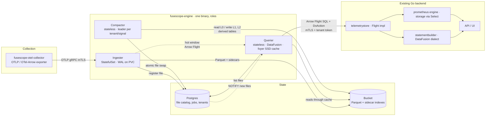

# FuseScope Engine · architecture design

> Status: proposal, 2026-10-24. Storage and query engine for OpenTelemetry
> telemetry (traces, logs, metrics) on object storage, candidate to replace
> ClickHouse in FuseScope.
> Engine license: Apache-2.0. Dependencies must be MIT, BSD, ISC or Apache-2.0.

## 1. Why an engine of our own

FuseScope inherited from SigNoz a Go backend coupled to ClickHouse at three
points: the `telemetrystore.TelemetryStore` interface returns a raw ClickHouse
connection, the `statementbuilder` packages emit ClickHouse-dialect SQL, and
dozens of materialized views in the collector schema do pre-aggregation.
ClickHouse delivers performance, but it costs expensive local disk, its own
replication, rebalancing on scale-out, and it ties the schema to an AGPL
repository.

The engine trades that for **stateless compute over a shared bucket**: Parquet
on S3, GCS, Azure Blob or MinIO, vectorized queries with Apache DataFusion, a
local SSD cache, and a small catalog in the Postgres we already run. Scaling is
adding queriers. Retention costs bucket prices.

This is not a ClickHouse reimplementation. It is an engine specialized in three
signals with known access patterns: filter by time and service, lookup by id,
aggregate by window, and text search over logs.

## 2. Architecture



In one sentence: collectors send OTLP to ingesters, which write a local WAL,
buffer in memory and flush Parquet plus indexes to the bucket, registering each
file in the catalog. Stateless queriers plan against the catalog, read the
bucket through an SSD cache, merge the hot window held by ingesters and answer
in Arrow Flight to the Go backend. A compactor keeps files large and sorted and
materializes the derived tables that replace the ClickHouse views.

### 2.1 Roles

| Role | State | Scaling | Responsibility |
|---|---|---|---|
| Ingester | WAL on local disk (PVC) | StatefulSet; tenant sharding by consistent hash in the collector or by a sticky load balancer | Receive OTLP/OTel-Arrow, validate, write WAL, buffer as Arrow, flush Parquet L0, serve the hot window |
| Querier | Cache only | Deployment, HPA on CPU and queue depth | Flight SQL and typed actions, catalog-driven planning, pruning, reads through foyer, fan-out to ingesters |
| Compactor | None | Deployment; one leader per (tenant, signal) via a Postgres lease | Merge L0 → L1 → L2, re-sort, rebuild indexes, derived tables, retention |
| Catalog | Postgres | Already in the stack | File list with summaries, compaction jobs, tenants, leases |

`--role all` runs the three roles in one process for development and small
installs, with MinIO or local disk as the bucket.

### 2.2 Write path

```
OTLP ──► authentication (mTLS or per-tenant bearer)
     ──► limits: message size, attributes per record, value size,
         new attribute keys per tenant per hour
     ──► normalization into the signal's Arrow schema (section 4)
     ──► WAL: append-only segment, record = len + crc32c + raw OTLP payload
         group commit: one writer thread drains the queue, appends the batch,
         fsyncs once and acknowledges every request in it; rotate every 64 MB
     ──► in-memory buffer: RecordBatches per (tenant, signal), sorted at flush
     ──► flush when: 128 MB, or 30 s, or end of hour
         1. sort by (service_name, timestamp)
         2. write Parquet L0 to the bucket under a temporary path
         3. write index sidecars (section 5)
         4. INSERT into the catalog with state "visible"
         5. checkpoint the WAL at the first still-buffered record
```

A file exists for the querier only after the catalog INSERT. Three things
make the flush idempotent under crashes at any step, with other requests
arriving meanwhile:

- The file id is derived from the WAL instance id (created with the WAL
  directory, so two ingesters or a recreated volume never collide), the tenant
  and the smallest WAL position in the buffer. Replay rebuilds the same
  minimum from the records, so the id survives a restart with no state beyond
  the log. The hot window takes its snapshot under the exclusive gate, with no
  request between its append and its push, so the id it announces for live
  rows is the id their file gets.
- Before uploading, the ingester appends a flush intent to the WAL naming the
  file id and the exact record range it covers. The range is exact because
  requests append to the WAL and to the buffer under a shared gate that the
  flush takes exclusively while it cuts the buffer, and its start is the
  smallest position in the buffer, not the position of the record that got
  there first. Replay groups records
  under their intents, so a retry produces the same object and the same
  catalog row even if later rows arrived during the original flush.
- Uploads never overwrite (conditional create), and registering an existing
  id verifies the immutable fields; a mismatch is an error, never a silent
  accept.

The checkpoint is a durable marker next to the segments: replay after a
restart starts there, which is what prevents rows already in the bucket from
being flushed twice. Its cut is chosen under the same exclusive gate, so a
record accepted while the checkpoint is chosen is above the cut and replay
still finds it.

Memory the caps do not see is bounded separately: at most `max_conversions`
requests are converted to Arrow before admission at a time, and a merge
reserves its inputs inside `max_memory_bytes`, never on top of it, taking at
most `coalesce_bytes` of them and nothing when the headroom holds fewer than
two adjacent batches. A flush reserves three copies of its inputs before
preparing the file, for the merged rows, the sorted rows and the encoder,
and admission keeps that room free for every live and flushing byte, so the
rows that fill the cap can always be the rows that free it. A batch larger than `coalesce_bytes` is a chunk as it
is, whatever the headroom, and groups are chosen around it. The
gate covers only the append and the push of a request, so a flush cut, a
checkpoint or a hot-window snapshot waits for the requests in that window,
not for the conversion queue; the hot-scan and checkpoint latencies are
exposed as histograms.

Buffers keep batches in WAL order, the order replay produces, so a file holds
the same rows in the same order whether it was built from live batches or
from replayed records, and a retry after a crash reproduces the object byte
for byte. Request batches are small, a dozen spans, and a flush would
concatenate thousands of them, so a coalescer merges complete runs of them
into chunks in the background: a run is complete when every position in it
is below the smallest position still travelling from the log to a buffer,
which the WAL writer tracks. Chunks preserve the order, cost a few
milliseconds each outside every lock, and pack live rows into a fraction of
the memory of the batches they replace. Up to `max_coalesces` chunks are
built at a time, each over its own run, so one tenant's backlog is merged
on several cores. A flush is cut inline but encoded, uploaded and registered
on its own task, at most `max_flushes` at a time, so the flusher keeps
coalescing while a file is written; a chunk finished after its rows were
cut replaces them in the flushing rows. What the hot window keeps after
registration is the file's rows as written, one sorted batch, for
`persisted_retain`: the querier scans the hot window first and lists files
after, so the retention must cover its file cache TTL plus one hot scan, and
the server refuses a shorter value. A hot scan carries the trace and span
ids a query pins, so a lookup ships those rows and no others.

### 2.3 Read path

```
Flight SQL / DoAction
  ──► authentication: backend mTLS + tenant JWT signed by the backend
  ──► read-only session: logical catalog holds only this tenant's tables
  ──► DataFusion planning
        prune 1: catalog      → files by time range and service set
        prune 2: indexes      → id bloom/xor, label postings, body ngrams
        prune 3: row groups   → min/max statistics from the Parquet footer
        prune 4: pages        → page index
  ──► budget: estimated bytes, files, memory; refuse before executing
  ──► vectorized execution, coalesced reads via object_store, foyer cache
  ──► union with the hot window: Flight fan-out to the tenant's ingesters
  ──► RecordBatch stream to the Go backend (zero-copy in arrow-go)
```

## 3. Bucket layout

```
s3://fusescope/
  t/{tenant_id}/
    traces/
      l0/dt=2026-10-24/hr=14/{ulid}.parquet
      l0/dt=2026-10-24/hr=14/{ulid}.idx          # sidecar: filters + summary
      l1/dt=2026-10-24/hr=14/{ulid}.parquet      # ~512 MB, closed hour
      l2/dt=2026-10-24/{ulid}.parquet            # ~1 GB, closed day
      derived/trace_summary/dt=.../{ulid}.parquet
      derived/service_graph_1m/dt=.../{ulid}.parquet
      derived/duration_sort/dt=.../{ulid}.parquet
      index/trace_id/dt=2026-10-24/hr=14/{ulid}.tix   # trace_id → files
    logs/
      l0/ l1/ l2/ derived/ index/ngram/...
    metrics/
      series/dt=.../{ulid}.parquet                # fingerprint, labels
      samples/l0/ l1/ l2/...                      # fingerprint, ts, value
      derived/rollup_5m/ derived/rollup_30m/
      index/postings/dt=.../hr=.../{ulid}.pst     # label=value → fingerprints
    tmp/{ulid}.parquet                            # write in progress
```

Rules:

- `tenant_id` is the first path component. It enables per-prefix IAM
  policies and tenant deletion by prefix.
- Day and hour partitions match time pruning and retention, which deletes
  whole prefixes.
- ULID names are sortable by creation time and collision-free across
  ingesters.
- Nothing is overwritten. Compaction writes new files and swaps the list in
  the catalog in one transaction. Old files are quarantined and deleted after
  the in-flight read TTL (default 1 h).

### 3.1 Parquet parameters

| Parameter | Value | Reason |
|---|---|---|
| Compression | zstd level 3 at L0, level 7 at L2 | L0 optimizes flush latency, L2 optimizes bucket cost |
| Row group | 1 M rows or 128 MB | Pruning granularity without a huge footer |
| Page index | on | Pruning inside a row group |
| Dictionary | on for low-cardinality strings | service_name, status, severity |
| Native bloom | trace_id, span_id, service_name, metric_name | Row-group pruning on equality |
| Sort order | traces and logs: (service_name, timestamp); samples: (fingerprint, timestamp) | Locality for the dominant filters |
| Target size | L0 128 MB, L1 512 MB, L2 1 GB | Fewer footers to fetch, larger sequential reads |

### 3.2 Catalog in Postgres

```sql
create table engine_file (
  id             uuid primary key,
  tenant_id      uuid not null,
  signal         smallint not null,           -- 1 traces, 2 logs, 3 metric samples, 4 metric series, 10+ derived
  level          smallint not null,           -- 0, 1, 2
  path           text not null unique,
  size_bytes     bigint not null,
  row_count      bigint not null,
  ts_min         timestamptz not null,
  ts_max         timestamptz not null,
  services       text[] not null default '{}', -- coarse pruning summary
  summary        bytea,                        -- binary summary: small filters, min/max of promoted columns
  state          smallint not null,           -- 0 writing, 1 visible, 2 quarantined
  created_at     timestamptz not null default now(),
  quarantined_at timestamptz
);
create index on engine_file (tenant_id, signal, ts_min, ts_max) where state = 1;

create table engine_compaction (
  id          uuid primary key,
  tenant_id   uuid not null,
  signal      smallint not null,
  inputs      uuid[] not null,
  outputs     uuid[],
  state       smallint not null,
  lease_owner text,
  lease_until timestamptz
);

create table engine_tenant (
  id              uuid primary key,
  retention_days  int not null default 15,
  max_keys_hour   int not null default 5000,  -- attribute key cardinality limit
  bytes_budget    bigint not null,             -- per-query scan budget
  qps_limit       int not null
);
```

The catalog is the single source of truth for which files exist. Each querier
keeps an in-memory copy per tenant, refreshed by `LISTEN` plus a safety poll
every 5 s. For interoperability with Trino, DuckDB and Spark the compactor
writes **Apache Iceberg** metadata for level L2 asynchronously. Iceberg is an
exported view, never the hot write path.

## 4. Arrow schemas

Schemas are versioned in `fs-schema`. Old and new files coexist because
DataFusion merges schemas and fills missing columns with null.

**Compatibility rule (ADR 0007).** Logical field names and semantics follow
the ones the Go backend already uses in `pkg/telemetryschema` and the
`statementbuilder` packages, so the DataFusion dialect is a syntax
translation, not a model translation. Physical encoding is chosen for Parquet
and diverges from ClickHouse where that pays off. CamelCase aliases
(`traceID`, `durationNano`, `serviceName`) and the v2 tables they served are
not carried over.

**Clean-room rule (ADR 0008).** The OTLP to schema mapping is specified from
the OpenTelemetry protocol and semantic conventions and from observed data,
never from the AGPL exporter code in the collector repository.

### Spans

| Column | Type | Note |
|---|---|---|
| ts_bucket_start | UInt64 | virtual partition column, seconds, 30 min buckets; the query builder already emits this predicate |
| timestamp | Timestamp(ns, UTC) | span start |
| trace_id | FixedSizeBinary(16) | binary, not hex; `hex()` UDF for the UI; literals converted by the dialect |
| span_id | FixedSizeBinary(8) | |
| parent_span_id | FixedSizeBinary(8) nullable | |
| trace_state | Utf8 | |
| flags | UInt32 | |
| name | Dictionary(Utf8) | |
| kind | Int8 | OTLP enum |
| kind_string | Dictionary(Utf8) | |
| duration_nano | UInt64 | |
| status_code | Int16 | OTLP enum |
| status_code_string | Dictionary(Utf8) | |
| status_message | Utf8 | |
| has_error | Boolean | status_code == ERROR |
| is_remote | Dictionary(Utf8) | |
| resource_fingerprint | UInt64 | xxh3 of the sorted resource attributes; internal, never compared across engines |
| resources_string | Map(Utf8, Utf8) | |
| attributes_string | Map(Utf8, Utf8) | |
| attributes_number | Map(Utf8, Float64) | |
| attributes_bool | Map(Utf8, Boolean) | |
| scope_name, scope_version | Utf8 | |
| scope_string | Map(Utf8, Utf8) | |
| events | List(Struct{timestamp, name, attributes}) | structured, no JSON strings; event attributes as a text map |
| links | List(Struct{trace_id, span_id, trace_state, attributes}) | |
| service_name, http_route, ... | Dictionary(Utf8), nullable | promoted columns with flat snake_case names, registry in `fs-schema` (`PROMOTED`); the Go storage layer maps logical attribute to physical column, as it does today for `attribute_string_http$$route` |

Promoted from day one because the Go backend and the UI depend on them:
`service.name` (resource), `http.route`, `http.request.method` and legacy
`http.method`, `http.response.status_code` and legacy `http.status_code`,
`db.system`, `db.name`, `db.operation`, `rpc.system`, `rpc.service`,
`rpc.method`, `messaging.system`, `messaging.operation`, `peer.service`,
`deployment.environment.name` and legacy `deployment.environment`. Each
column tries current and legacy semconv keys in order. The full rule set with
sources is `crates/fs-schema/MAPPING.md`.

### Logs

ts_bucket_start, timestamp, observed_timestamp, id (ULID, UInt128 as
FixedSizeBinary(16)), trace_id, span_id, trace_flags (UInt32),
severity_text (Dictionary), severity_number (UInt8), body (Utf8),
resource_fingerprint, resources_string, attributes_string, attributes_number,
attributes_bool, scope_name, scope_version, scope_string, promoted.*.

### Metrics

`series`: fingerprint (UInt64), metric_name (Dictionary), temporality
(Dictionary), type (gauge, sum, histogram, exp_histogram, summary), unit,
description, is_monotonic, labels (Map(Utf8, Utf8), not a JSON string),
first_seen, last_seen.

`samples`: fingerprint, metric_name (Dictionary, kept for file pruning),
unix_milli (Int64), value (Float64). The `env` column of `samples_v4` is not
carried over; it is a label. Histograms are exploded into one series per
bucket at ingest, as Prometheus does. Exponential histograms keep a dedicated
Struct column.

## 5. Indexes

Indexes live in the bucket next to the data and are **rebuilt by the
compactor** at every level. They are never the source of truth.

| Index | Format | Serves | Reference |
|---|---|---|---|
| Native Parquet bloom | inside the file | equality on trace_id, span_id, service_name, metric_name | parquet-rs |
| `.idx` sidecar | xor filter per column + min/max of promoted columns | file pruning without opening the footer | Tempo |
| `index/trace_id/*.tix` | sorted table trace_id → file list, per hour | open two or three files for a trace instead of thousands | Tempo |
| `index/ngram/*.ngb` | ngram (n=3) and token bloom over body, per file | `LIKE`, `contains`, log text search | ClickHouse ngrambf_v1 |
| `index/postings/*.pst` | roaring bitmaps, label=value → fingerprints, per hour | PromQL matcher resolution | Prometheus TSDB |
| Tantivy (phase 2) | inverted index per file | full-text search with ranking and phrases | Quickwit |

Every sidecar carries a header with version, length and an xxh3 checksum. A
corrupt or missing sidecar degrades to a file scan, never to an error.

## 6. Hot window

Data from the last seconds up to the flush exists only in the ingester. The
querier needs it for "last 5 minutes" dashboards.

- Each ingester exposes Flight with `hot.scan(tenant, signal, range,
  projection, filter)` over its in-memory RecordBatches.
- The querier asks the catalog how far the bucket covers (`max(ts_max)` per
  tenant and signal) and sends ingesters only the range after that.
- The merge is a DataFusion `UnionExec` with deduplication on
  `(ingester_id, wal_offset)` for the case of a flush concurrent with the
  query.
- Ingesters are discovered through the catalog (heartbeat every 2 s in
  `engine_ingester`). An ingester silent for 10 s is skipped and the querier
  marks the result as partial in a Flight header.

## 7. Compaction and derived tables

```
L0  (128 MB, per flush)      ──► L1 (512 MB, closed hour, re-sorted)
L1  (24 files of one day)    ──► L2 (1 GB, closed day, zstd 7, promoted columns)
```

At every level the compactor:

1. Reads the inputs, re-sorts, writes outputs under `tmp/`, writes new
   sidecars.
2. In one transaction: marks inputs `quarantined`, inserts outputs as
   `visible`. Queriers holding an older copy keep reading the inputs until
   the quarantine TTL, with no error.
3. Updates derived tables incrementally from the inputs.
4. Decides promotions: an attribute filtered in more than N% of the last
   week's queries, using querier statistics, becomes a native column at L2.

Derived tables replacing the ClickHouse materialized views:

| Derived | Replaces | Key |
|---|---|---|
| trace_summary | signoz_traces.trace_summary | trace_id, start, end, num_spans, services |
| service_graph_1m | dependency_graph_minutes | (src, dst, minute): count, error_count, p50/p99 via t-digest |
| duration_sort | durationSort | top-k per service and operation, per hour |
| usage_1h | usage | bytes and rows per tenant, signal, service, hour |
| attribute_keys | tag_attributes, span_attributes_keys | key, type, count, first and last seen |
| rollup_5m, rollup_30m | samples_v4_agg_5m, samples_v4_agg_30m | fingerprint, window: min, max, sum, count, last |

Retention: the compactor deletes day prefixes beyond the tenant's
`retention_days`, first in the catalog, then in the bucket. Bucket lifecycle
rules are the safety net, never the primary mechanism, because the catalog
must never point at files that do not exist.

## 8. Contract with the Go backend

### 8.1 Transport

Arrow Flight over gRPC with mTLS between backend and queriers. Two kinds of
operation:

**Flight SQL** for everything that is generated SQL in the `statementbuilder`
packages today. Dialect: DataFusion, close to PostgreSQL. Functions registered
by the engine: `attr_string(attributes, 'http.method')`, `attr_number(...)`,
`attr_bool(...)`, `has_attr(...)`, `body_contains(body, 'text')`,
`time_bucket(interval, ts)`, `quantile_tdigest(col, 0.99)`.

**Typed DoAction** for hot paths where SQL only gets in the way:

| Action | Input | Output | Used by |
|---|---|---|---|
| `trace.lookup` | tenant, trace_id, optional range | spans of the trace | trace detail view |
| `metrics.select` | tenant, label matchers, range, optional step | series with samples | Prometheus `storage.Queryable` in Go |
| `metrics.label_values` | tenant, label, matchers | values | autocomplete |
| `metadata.keys` | tenant, signal, prefix | attribute keys with type | query builder |
| `catalog.estimate` | tenant, SQL | bytes, files, row groups after pruning | `TelemetryStore.Estimate` |
| `catalog.explain` | tenant, SQL | logical and physical plan | `TelemetryStore.Plan` and `Indexes` |

### 8.2 Changes in Go

| Where | Change |
|---|---|
| `pkg/telemetrystore` | The interface stops exposing `ClickhouseDB() clickhouse.Conn`. It exposes `Query(ctx, stmt, args) (arrow.RecordReader, error)` and `Do(ctx, action, payload) (arrow.RecordReader, error)`. `flighttelemetrystore` is born next to `clickhousetelemetrystore`. |
| `pkg/statementbuilder/*` | Gain a dialect. ClickHouse SQL generation is already encapsulated here; the DataFusion version is a second backend of the same builders, tested against the same cases. |
| `pkg/prometheus/clickhouseprometheusv2` | Gains a sibling `flightprometheus` implementing `storage.Queryable` on top of `metrics.select`. The Prometheus PromQL engine stays in Go. |
| `pkg/telemetrymetadata` | Reads the `attribute_keys` derived table through `metadata.keys`. |
| `pkg/query-service/app/{logs,traces,metrics}/{v3,v4}` | Not ported. Legacy code that SigNoz itself is retiring in favor of querier v5. |
| `fusescope-otel-collector` | Swaps the ClickHouse exporter for the standard OTLP exporter pointing at the ingesters. The schema stops living in the AGPL repository. |

A `telemetrystore.provider: clickhouse | flight` flag selects the
implementation at runtime, allowing dual-write from the collector and result
comparison during migration.

## 9. Performance

### 9.1 Principles

1. **Never read what the query does not need.** Four pruning levels before a
   single data byte is read (section 2.3). The in-memory catalog answers
   level 1 with no I/O.
2. **Large, coalesced I/O.** `object_store` merges nearby byte ranges into
   one request. 128 MB row groups make sequential reads worthwhile.
3. **Layered cache.** foyer with memory and SSD: footers and page indexes of
   all visible files are pre-warmed when they enter the catalog; filters and
   postings are cached on first read; data pages use LRU with frequency-based
   admission so one-off scans do not evict the hot set.
4. **Hot window in memory.** The last seconds never touch the bucket.
5. **Pre-aggregate where the query is predictable.** Rollups, service graph,
   trace summary and duration sort are computed once by the compactor, not
   on every dashboard load.
6. **Zero-copy to Go.** Flight delivers Arrow IPC; `arrow-go` reads it
   without deserializing into structs.
7. **Budget before executing.** The planner estimates bytes and files after
   pruning. Above the tenant budget the query is refused with an error that
   says what to do, like the `Estimate` the backend already uses today.

### 9.2 Initial targets

Measured with a warm cache, 1 TB per tenant, 15-day retention, S3 bucket in
the same region. Phase 1 uses them to accept or reject the engine.

| Query | Target p95 |
|---|---|
| trace by id | 300 ms |
| span list, 1 service, 15 min, filter on a promoted attribute | 500 ms |
| p99 latency per service, 24 h | 2 s |
| logs, 1 service, 1 h, attribute filter plus `contains` on body | 1 s |
| PromQL rate over 200 series, 6 h, step 30 s | 800 ms |
| "last 5 min" dashboard, 8 panels | 1 s total |
| ingest per ingester (4 vCPU) | 150 MB/s of uncompressed OTLP |

### 9.3 Where ClickHouse still wins, and the answer

| Scenario | Why ClickHouse wins | Answer |
|---|---|---|
| High-cardinality GROUP BY over billions of rows, cold cache | local NVMe | foyer SSD cache pre-warmed from the catalog; sorted L2 reduces rows touched; budget refuses scans that do not fit |
| Data from right now | synchronous insert into the table | Hot window via ingesters |
| Materialized views | native | Compactor derived tables |
| Metrics with millions of active series | primary indexes in memory | Roaring postings per hour, cached; rollups; per-tenant cardinality limit |

## 10. Security

### 10.1 Tenant isolation

- `tenant_id` comes from the JWT signed by the Go backend, never from the SQL
  text. The engine builds one DataFusion logical catalog per session holding
  only that tenant's tables. There is no "global" table.
- Per-prefix IAM policies on `t/{tenant_id}/` when a large customer gets its
  own bucket. For multi-tenant in one bucket, isolation is the engine's job,
  and the backend is the only network client of the engine.
- Deleting a tenant is: mark in the catalog, stop accepting ingest, delete
  the prefix, remove from the catalog. Audited.

### 10.2 SQL surface

Flight SQL exposes a general-purpose SQL engine. That is the largest attack
surface and is handled as follows:

- Sessions are always read-only. DDL, DML, `COPY`, `CREATE EXTERNAL TABLE`,
  `INSERT` and table functions that take a path (`read_parquet`, `read_csv`
  and the like) are removed from the function registry and rejected by the
  analyzer. A query that mentions them fails at parse time.
- `information_schema` shows only the session tenant's tables.
- Per-query limits: memory through the DataFusion `MemoryPool` with spill to
  SSD, timeout, maximum files, maximum output rows, and the tenant byte
  budget.
- Per-tenant limits: QPS and concurrent queries, with fair queuing between
  tenants so a noisy tenant does not affect the others.
- Identifiers and literals keep going through `pkg/clickhousesql` in Go,
  renamed to a dialect-neutral package, because injection is prevented at the
  source.

### 10.3 Ingest

- mTLS between collector and ingester, or a per-tenant bearer token where the
  collector runs on the customer side.
- Limits: gRPC message size (default 16 MB), attributes per record, key and
  value size, nesting depth, and new attribute keys per tenant per hour.
  Above those, the record is accepted with the excess attributes dropped and
  a per-tenant drop counter, so a cardinality attack does not take down the
  pipeline of the tenant under attack.
- Per-tenant rate limit in bytes per second.
- WAL with crc32c per record and fsync per batch. PVC volume encrypted by the
  provider.

### 10.4 Data at rest and in transit

- Bucket with server-side encryption (SSE-KMS or equivalent), TLS required,
  public access blocked, optional versioning for tenants with immutability
  requirements.
- Three IAM identities: the ingester writes to `tmp/` and `l0/` and reads
  nothing; the querier only reads; the compactor reads, writes and deletes.
  Credentials via Kubernetes workload identity, never in configuration files.
- Phase 2: Parquet modular encryption per column for fields marked sensitive
  (log body, tenant-listed attributes), with a key per tenant. parquet-rs
  supports it.
- Catalog Postgres with TLS and one user per role, minimal `GRANT`s.

### 10.5 Supply chain and code

- `cargo-deny` in CI: allowed licenses are only Apache-2.0, MIT, BSD, ISC,
  Unicode and Zlib; RustSec advisories block the merge; crates.io is the only
  source.
- `#![forbid(unsafe_code)]` in every crate except `fs-cache` and `fs-index`,
  which may need audited `unsafe` for mmap, each block justified in a
  comment.
- Distroless image, non-root process, read-only filesystem except WAL and
  cache. SBOM generated at build.
- Engine logs never contain telemetry payloads, tokens or keys. `debug` logs
  ids and sizes, not bodies.
- Every query produces an audit event with tenant, JWT subject, query hash,
  bytes read, duration and outcome, delivered to the backend through the
  hooks `telemetrystore` already has.

## 11. Rust workspace

```
fusescope-engine/
  Cargo.toml                 # workspace, lints, shared deps
  deny.toml                  # cargo-deny: licenses and advisories
  rust-toolchain.toml
  crates/
    fs-schema/       versioned Arrow schemas, OTLP → Arrow conversion
    fs-catalog/      Postgres catalog, in-memory cache, LISTEN/NOTIFY, Iceberg export
    fs-wal/          append-only segments, crc32c, replay
    fs-ingest/       OTLP/OTel-Arrow server, limits, buffer, flush, hot.scan
    fs-index/        xor/bloom, ngram bloom, roaring postings, trace_id → files
    fs-cache/        foyer wrapper: footers, page index, sidecars, pages
    fs-query/        TableProvider per signal, pruning, hot-window union,
                     UDFs, Flight SQL, DoAction, budget, SQL sandbox
    fs-compactor/    levels, derived tables, promotions, retention, leases
    fs-auth/         mTLS, tenant JWT, per-role identity
    fs-server/       single binary, --role ingester|querier|compactor|all
  docs/
    adr/             recorded decisions
```

Planned dependencies, all Apache-2.0 or MIT:

| Crate | Role |
|---|---|
| arrow, parquet | in-memory and on-disk format |
| datafusion | planning and execution |
| arrow-flight | transport, Flight SQL |
| object_store | S3, GCS, Azure, local |
| foyer | hybrid memory and SSD cache |
| opentelemetry-proto, tonic, prost | OTLP gRPC |
| sha2, getrandom | ingest token hashing and generation |
| sqlx | Postgres |
| roaring | postings |
| xorf | xor filters |
| twox-hash (xxh3), crc32c | fingerprints and WAL checksums |
| iceberg | L2 metadata export |
| tokio, tracing | runtime and the engine's own observability |
| tantivy | phase 2 |

## 12. Phases

Every phase has an exit criterion. If it is not met, continuing is an explicit
decision, not inertia.

| Phase | Deliverable | Exit criterion |
|---|---|---|
| 0 · Foundation | workspace, fs-schema, fs-catalog, fs-wal, fs-server with `--role all`, CI with cargo-deny | `cargo test` green, binary starts against local MinIO |
| 1 · Traces | OTLP ingest, L0 flush, trace_id indexes, querier with Flight SQL and `trace.lookup`, `flighttelemetrystore` in Go, dual-write from the collector | trace targets in section 9.2 within the same order of magnitude as ClickHouse on the same data; identical results in a diff |
| 2 · Logs and compactor | ngram bloom, hot window, L1/L2, trace and log derived tables, retention | logs view and service map served by the engine in staging for two weeks without regression |
| 3 · Metrics | series and samples, postings, `metrics.select`, `flightprometheus`, rollups | PromQL alerts and dashboards match ClickHouse in shadow for two weeks |
| 4 · Cutover | history migration via Parquet export, ClickHouse shutdown, removal of `clickhousetelemetrystore` | production without ClickHouse for 30 days |

## 13. Risks

| Risk | Mitigation |
|---|---|
| Effort underestimated: parity is 12 to 18 months for a small team | Phases with exit criteria; phase 1 is cheap and decides whether to continue |
| High-cardinality metrics get slow | Cached postings, rollups, per-tenant cardinality limit, and metrics last, when the rest already pays for itself |
| Operating four components instead of one ClickHouse | Single binary with roles, `all` mode, Helm chart with one `values` |
| Catalog consistency with the bucket | Catalog is the source of truth, files visible only after INSERT, quarantine before delete, orphan collector |
| DataFusion SQL surface | Sandbox from section 10.2, CI denial tests for every blocked construct |
| Dependence on young projects (foyer, iceberg-rust) | Both run in production (RisingWave, Apache); isolated behind traits in fs-cache and fs-catalog |

## 14. Recorded decisions

| ADR | Decision | Rejected alternative |
|---|---|---|
| 001 | Own catalog in Postgres; Iceberg only as L2 export | Iceberg as primary catalog: commit contention and manifest bloat under frequent flushes |
| 002 | PromQL stays in the Go Prometheus engine; the engine exposes Select | PromQL in Rust: reimplementation with no functional gain |
| 003 | Ngram bloom for log text in phase 2; Tantivy later | Tantivy from day one: complexity without proven product demand |
| 004 | Single binary with roles | One binary per role: worse for development and small installs |
| 005 | Legacy query-service v3/v4 is not ported | Porting: code upstream is retiring |
| 006 | Collector exports standard OTLP to the ingester | Keeping an adapted ClickHouse exporter: schema stays in the AGPL repository |
| 007 | Logical schema compatible with the Go backend, physical encoding free | Byte-compatible ClickHouse schema: carries hex ids, JSON strings and camelCase aliases into Parquet |
| 008 | Clean-room mapping from OTLP; AGPL exporter code is never read | Porting the exporter's mapping: AGPL contamination of an Apache-2.0 engine |
